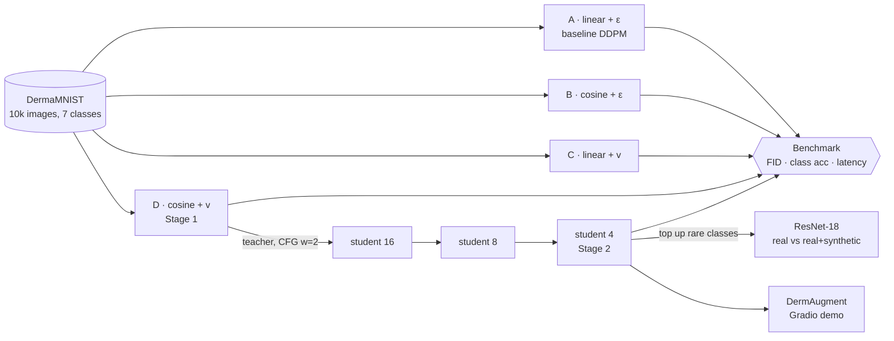
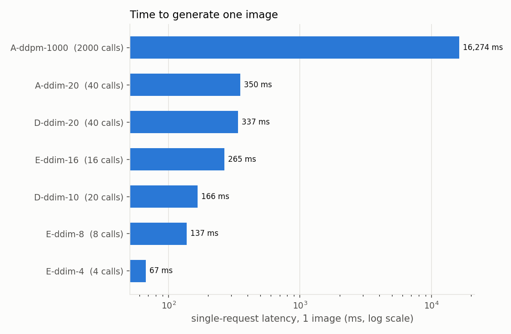

# FastDiff-Med: 4-step diffusion for synthetic skin-lesion augmentation

> **4 steps vs 1000 · 500× fewer network calls · 243× lower single-image latency (16.3 s → 67 ms on a T4) ·
> FID 28.7 vs 16.7 for the 1000-step baseline · synthetic rare-class augmentation: +7.7 pts balanced accuracy
> and +4.4 pts macro-F1 when only 20% of the real data is available**
>
> A 2,360-image synthetic training set takes **8 seconds** with the 4-step student vs **~65 minutes** with the
> 1000-step baseline.

**Demo:** run `python -m app.app` (works on CPU) or [notebook 04](notebooks/04_demo_gradio.ipynb). See *How to run*.

A class-conditional diffusion model on **DermaMNIST** (7 skin-lesion types, 32×32), made fast
without changing the network:

* **Stage 1, re-engineered diffusion (1000 → 20 steps):** cosine noise schedule, v-prediction and a
  deterministic DDIM sampler with trailing timesteps. The U-Net, data and training budget stay
  *identical* to the baseline, so every gain comes from the formulation.
* **Stage 2, progressive distillation (32 → 16 → 8 → 4 steps):** a student learns to match two teacher
  steps with one, and classifier-free guidance is folded in, so each step costs **one** network call.
  The baseline with guidance needs 2,000 calls per image; the student needs **4**.
* **Real-world test:** DermaMNIST is heavily imbalanced (nevi ≈ 67%, dermatofibroma ≈ 115 images). We
  top up the rare classes with student samples and measure whether a ResNet-18 classifier gets better
  at rare lesions, compared with real data alone and with plain oversampling.

Course project, *Generative AI*, Phases 1–4:
[comparative study](docs/phase1_comparative_study.md) ·
[bottleneck and proposal](docs/phase2_proposal.md) ·
[results](docs/phase3_results.md) · [build plan](docs/BUILD_PLAN.md)

## Pipeline



## Results

All numbers are from one T4 GPU run (Kaggle) in the notebooks' `LITE` setting: FID on 2,000 samples per
configuration (500 for the slow 1000-step baseline) against the real DermaMNIST test images, and class
accuracy of samples scored by an independent ResNet-18 judge (its balanced accuracy on real test images is 0.60).

### Speed vs. quality

| Engine | Steps | Network calls / image | FID ↓ | Class acc ↑ | Single-image latency | Batched ms / image |
|---|---:|---:|---:|---:|---:|---:|
| Baseline · DDPM (A) | 1000 | 2000 | **16.7**¹ | 0.783 | 16,274 ms | 1,598 |
| Baseline · DDIM (A) | 20 | 40 | 53.8 | 0.729 | 350 ms | 32.0 |
| **FastDiff · DDIM (D, Stage 1)** | 20 | 40 | 24.1 | **0.812** | 337 ms | 32.0 |
| Student (E, Stage 2) | 16 | 16 | 18.7 | 0.795 | 265 ms | 12.9 |
| Student (E, Stage 2) | 8 | 8 | 22.3 | 0.792 | 137 ms | 6.4 |
| **Student (E, Stage 2)** | **4** | **4** | 28.7 | 0.795 | **67 ms** | **3.2** |

¹ Measured on 500 samples because it is so slow. FID is biased *upward* with fewer samples, so the
baseline's true FID is, if anything, slightly better than 16.7.

**What this shows**
* At the **same 20 steps**, Stage 1 more than halves FID (53.8 → 24.1) and raises sample class accuracy
  (0.73 → 0.81), with the same network and the same training budget.
* The **4-step student** (4 network calls) beats the baseline at 20 steps (40 calls) on both FID and class
  accuracy, and is **243× faster per image** than the original 1000-step sampler.
* It does **not** fully match the 1000-step baseline's FID (28.7 vs 16.7); the 16-step student comes closest
  (18.7). Class accuracy is on par (0.795 vs 0.783).




### Ablation: which change matters? (same U-Net, same training budget, DDIM trailing)

| Run | Schedule | Target | FID @ 5 steps | FID @ 10 steps | FID @ 20 steps | Class acc @ 20 |
|---|---|---|---:|---:|---:|---:|
| A (baseline) | linear | ε | 143.6 | 93.5 | 53.8 | 0.729 |
| B | cosine | ε | 101.3 | 66.3 | 37.8 | 0.551 |
| C | linear | v | — | — | — | — |
| **D (Stage 1)** | cosine | v | **94.3** | **48.1** | **24.1** | **0.812** |

* The **cosine schedule** alone (A → B) lowers FID at every budget, but with ε-prediction the samples lose
  class identity (class accuracy drops to 0.33–0.55).
* Adding **v-prediction** (B → D) fixes that and lowers FID further: D is best at every step count.
* Run C is missing: the free Colab GPU quota ran out at 10,000 of its 12,000 steps, and a partly trained
  run would not be a fair comparison, so it was left out (see *Limitations*).


### Real-world impact: augmenting rare lesion classes

ResNet-18 on the official DermaMNIST test split, mean ± std over 3 seeds. Every class except the
largest is topped up to the size of the second-largest class, using either duplicated real images
(oversampling) or 4-step student samples.

| Real data | Training set | Balanced accuracy ↑ | Macro-F1 ↑ | Dermatofibroma recall |
|---|---|---:|---:|---:|
| 100% | real | 0.569 ± 0.028 | **0.565 ± 0.024** | 0.26 |
| 100% | real + oversampling | 0.550 ± 0.035 | 0.535 ± 0.021 | 0.30 |
| 100% | **real + synthetic (student)** | **0.587 ± 0.004** | 0.563 ± 0.021 | **0.41** |
| 20% | real | 0.429 ± 0.019 | 0.427 ± 0.040 | 0.06 |
| 20% | real + oversampling | 0.430 ± 0.017 | 0.388 ± 0.041 | 0.09 |
| 20% | **real + synthetic (student)** | **0.506 ± 0.036** | **0.471 ± 0.050** | **0.35** |

* **With little real data (20%)**, synthetic augmentation gives a clear gain: **+7.7 pts balanced accuracy**,
  **+4.4 pts macro-F1**, and dermatofibroma (the rarest class) recall rises from 0.06 to 0.35. Plain
  oversampling does not help (macro-F1 drops).
* **With all the real data**, the gain is small: balanced accuracy +1.8 pts with much lower variance across
  seeds, but macro-F1 is unchanged (0.565 vs 0.563, within noise).
* Generating the 2,360 synthetic images took **8.2 s** with the 4-step student vs **~64.5 min** with the
  1000-step baseline (extrapolated from 100 images), about **470× faster**.


Full tables, including per-class recall and sample accuracy: **[docs/phase3_results.md](docs/phase3_results.md)**.

## How to run

All training runs on a free **Colab T4**. Every notebook clones this repo, saves checkpoints and
results to `MyDrive/fastdiff-med/` and resumes after a disconnect. Set `QUICK = True` in the setup
cell for a ~5-minute smoke test.

| Notebook | What it does | T4 time |
|---|---|---|
| [](https://colab.research.google.com/github/shreyu20sharma/fastdiff-med/blob/main/notebooks/01_train_ablation.ipynb) `01_train_ablation` | dataset overview, trains runs A–D, loss curves | ~1 h per run |
| [](https://colab.research.google.com/github/shreyu20sharma/fastdiff-med/blob/main/notebooks/02_distillation.ipynb) `02_distillation` | progressive distillation 32→16→8→4, grids per round | ~1 h |
| [](https://colab.research.google.com/github/shreyu20sharma/fastdiff-med/blob/main/notebooks/03_benchmark_and_impact.ipynb) `03_benchmark_and_impact` | judge classifier, FID/latency benchmark, augmentation experiment, report | ~2 h |
| [](https://colab.research.google.com/github/shreyu20sharma/fastdiff-med/blob/main/notebooks/04_demo_gradio.ipynb) `04_demo_gradio` | DermAugment Gradio demo (public link) and Hugging Face Space bundle | minutes |

**Out of Colab GPU quota?** Run [00_pack_for_kaggle](notebooks/00_pack_for_kaggle.ipynb) on a Colab
CPU runtime to zip the trained checkpoints, upload the zip as a Kaggle dataset, and run
[02_03_distill_and_benchmark_kaggle](notebooks/02_03_distill_and_benchmark_kaggle.ipynb) (notebooks 02 + 03 in one run) with
*Save & Run All*. It runs in the background on Kaggle's free GPU, so the laptop can be closed.
`LITE = True` in the setup cell halves the GPU time of notebooks 02 and 03.

**Evidence of the actual runs**
* [notebooks/executed/02_03_distill_and_benchmark_kaggle_executed.ipynb](notebooks/executed/02_03_distill_and_benchmark_kaggle_executed.ipynb):
  the Kaggle run with all its outputs (logs, tables, charts).
* [results/training_logs/](results/training_logs/): the loss logs of runs A, B and D (12,000 steps each, about
  3.3 it/s on a Colab T4) and of the three distillation rounds. The loss curves are in
  [results/loss_curves.png](results/loss_curves.png).

The same steps from a shell:

```bash
pip install -r requirements.txt
python -m src.train --run D --steps 12000 --ckpt_dir checkpoints          # also A, B, C
python -m src.distill --teacher checkpoints/D/ema.pt --ckpt_dir checkpoints
python -m src.judge_classifier --ckpt_dir checkpoints
python -m src.evaluate --ckpt_dir checkpoints                              # -> results/, docs/phase3_results.md
python -m src.augment_experiment --ckpt_dir checkpoints
python -m app.app --ckpt_dir checkpoints --results_dir results             # demo on http://127.0.0.1:7860
pytest tests                                                               # CPU unit tests
```

`FASTDIFF_FAKE_DATA=1` swaps in tiny random data so the whole pipeline can be smoke-tested offline on CPU.

### Repository layout

```
src/
  data.py               DermaMNIST loader (28→32 px, [-1, 1], GPU-resident tensors)
  unet.py               class-conditional U-Net (64/128/256 ch, attention at 8×8, null label for CFG)
  diffusion.py          schedules, ε/v conversions, DDPM and DDIM samplers, CFG, distillation target
  train.py              ablation training (AMP, EMA, resumable checkpoints, loss log)
  distill.py            progressive distillation with folded guidance (resumable per round)
  sampling.py           batched sampling and CUDA-synchronised timing
  judge_classifier.py   ResNet-18 judge and shared classifier training and metrics
  evaluate.py           FID, class accuracy, latency, charts and sample grids
  augment_experiment.py real vs real+oversample vs real+synthetic
  report.py             writes docs/phase3_results.md from the CSVs
app/app.py              DermAugment Gradio UI (Colab, local or Hugging Face Spaces)
notebooks/              the four Colab notebooks above
tests/                  diffusion maths and sampler tests
results/                charts and CSVs from the Colab runs
```

## Method in one paragraph

The baseline's linear schedule leaves the last ~40% of timesteps as almost pure noise, and
ε-prediction recovers x̂₀ by dividing by √ᾱₜ, which amplifies errors when only a few large steps are
taken. A **cosine schedule** spreads the denoising work evenly. **v-prediction**
(v = √ᾱ·ε − √(1−ᾱ)·x₀) recovers x̂₀ and ε̂ without division. **Trailing DDIM timesteps** always start
at t = T−1, so sampling starts from pure noise as in training. Even then a solver needs about 20 steps,
so **progressive distillation** trains a student to make one step land exactly where two teacher
steps land. It solves for the x̃₀ that a single DDIM step would need, trains on it with max(SNR, 1)
weighting, and halves the step count each round. Details and equations are in
[docs/phase2_proposal.md](docs/phase2_proposal.md).

## Limitations

* **32×32 images.** DermaMNIST is heavily downsampled. FID uses ImageNet Inception features on
  upsampled tiny images, so it is useful for *relative* comparisons between our configurations but
  not comparable with published FIDs.
* **Augmentation gains depend on data size.** The gain is clear with 20% of the real data but small with all
  of it, and comes from one classifier (ResNet-18) and 3 seeds.
* **Small, imbalanced data.** The rarest classes have only about 100 training images, so the model
  sees little variety there and synthetic images may mostly recombine what it has seen. Class
  accuracy is scored by a judge that is itself imperfect on rare classes (its own test accuracy is
  reported for reference).
* **Incomplete ablation and reduced evaluation.** Run C (linear + v) stopped at 10,000 of 12,000 steps when the
  free Colab GPU quota ran out and was excluded, so the effect of v-prediction is shown only on top of the cosine schedule (B → D).
  Distillation and evaluation ran on Kaggle in the `LITE` setting (2,000 FID samples, 1,500 iterations per
  distillation round, 20 classifier epochs); the full setting would give tighter numbers.
* **Quality gap at 4 steps.** The 4-step student's FID (28.7) is still worse than the 1000-step baseline's
  (16.7); 8–16 student steps close most of that gap at 2–4× the cost.
* **One dataset, short training.** Each run is 12,000 steps (about 1 h on a Colab T4). Longer training would improve
  absolute quality for every configuration.
* **Distillation cost.** The 4-step student needs extra training (about 40 min) and inherits any
  biases of its teacher; guidance strength is fixed at distillation time.
* **Not a medical device.** See the disclaimer below.

## References

* Ho, Jain & Abbeel (2020). *Denoising Diffusion Probabilistic Models.* NeurIPS.
* Song, Meng & Ermon (2021). *Denoising Diffusion Implicit Models.* ICLR.
* Nichol & Dhariwal (2021). *Improved Denoising Diffusion Probabilistic Models.* ICML.
* Ho & Salimans (2022). *Classifier-Free Diffusion Guidance.* NeurIPS Workshop.
* Salimans & Ho (2022). *Progressive Distillation for Fast Sampling of Diffusion Models.* ICLR.
* Lin, Liu, Li & Yang (2024). *Common Diffusion Noise Schedules and Sample Steps are Flawed.* WACV.
* Heusel et al. (2017). *GANs Trained by a Two Time-Scale Update Rule Converge to a Local Nash Equilibrium* (FID). NeurIPS.

### Dataset citation (MedMNIST)

```bibtex
@article{medmnistv2,
  title   = {MedMNIST v2 - A large-scale lightweight benchmark for 2D and 3D biomedical image classification},
  author  = {Yang, Jiancheng and Shi, Rui and Wei, Donglai and Liu, Zequan and Zhao, Lin and Ke, Bilian and Pfister, Hanspeter and Ni, Bingbing},
  journal = {Scientific Data},
  volume  = {10}, number = {1}, pages = {41}, year = {2023}
}
```
DermaMNIST is derived from HAM10000 (Tschandl, Rosendahl & Kittler, 2018, *Scientific Data* 5:180161),
licensed CC BY-NC 4.0.

## Disclaimer

⚠️ This project is for **research and education only**. The images are synthetic and generated
by a model trained on low-resolution public data. They are not real patients, have not been
validated clinically, and **must not be used for diagnosis or any clinical decision.**
