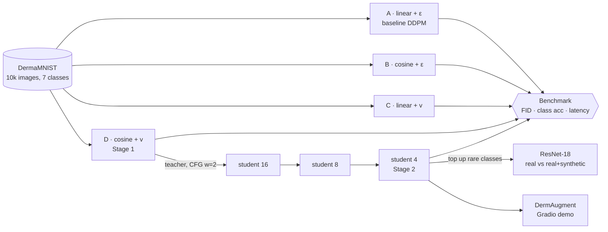
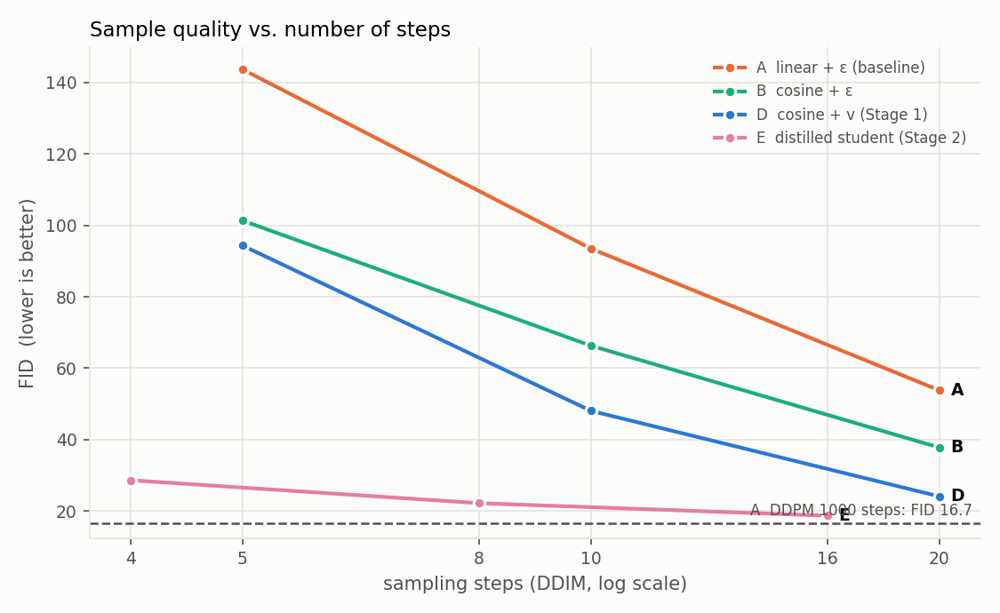
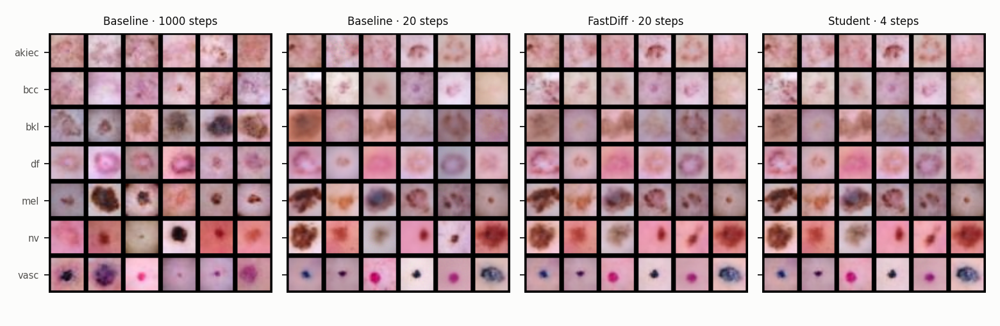
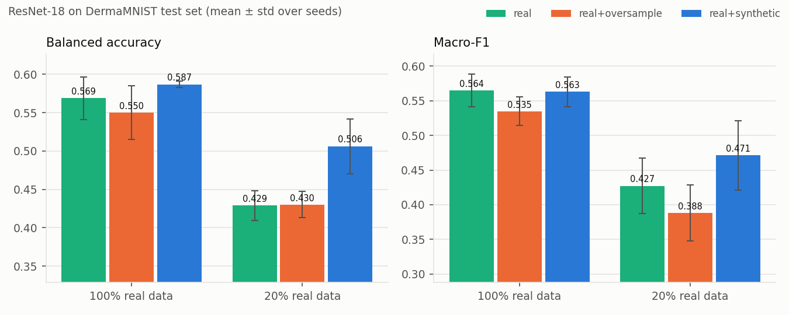

# FastDiff-Med: 4-step diffusion for synthetic skin-lesion augmentation

> **4 steps vs 1000 · ~500× fewer network calls · FID `‹S›` vs `‹B›` (baseline DDPM-1000) ·
> `‹L›`× lower single-image latency · `‹+Z›` pts macro-F1 with synthetic rare-class augmentation**
>
> _Placeholders `‹…›` are filled from `results/*.csv` after the Colab runs (see `docs/phase3_results.md`)._

**Demo:** `‹Hugging Face Space link›` · 

A class-conditional diffusion model on **DermaMNIST** (7 skin-lesion types, 32×32), made fast
without changing the network:

* **Stage 1, re-engineered diffusion (1000 → 20 steps):** cosine noise schedule, v-prediction and a
  deterministic DDIM sampler with trailing timesteps. The U-Net, data and training budget stay
  *identical* to the baseline, so every gain comes from the formulation.
* **Stage 2, progressive distillation (32 → 16 → 8 → 4 steps):** a student learns to match two teacher
  steps with one, and classifier-free guidance is folded in, so each step costs **one** network call.
  The baseline with guidance needs 2,000 calls per image; the student needs **4**.
* **Real-world test:** DermaMNIST is heavily imbalanced (nevi ≈ 67%, dermatofibroma ≈ 115 images). We
  top up the rare classes with student samples and measure whether a ResNet-18 classifier gets better
  at rare lesions, compared with real data alone and with plain oversampling.

Course project, *Generative AI*, Phases 1–4:
[comparative study](docs/phase1_comparative_study.md) ·
[bottleneck and proposal](docs/phase2_proposal.md) ·
[results](docs/phase3_results.md) · [build plan](docs/BUILD_PLAN.md)

## Pipeline



## Results

### Speed vs. quality

| Engine | Steps | Network calls / image | FID ↓ | Class acc ↑ | Single-image latency (T4) |
|---|---:|---:|---:|---:|---:|
| Baseline · DDPM (A) | 1000 | 2000 | ‹› | ‹› | ‹› ms |
| Baseline · DDIM (A) | 20 | 40 | ‹› | ‹› | ‹› ms |
| **FastDiff · DDIM (D)** | 20 | 40 | ‹› | ‹› | ‹› ms |
| **Student (E)** | **4** | **4** | ‹› | ‹› | ‹› ms |




### Ablation: which change matters? (same U-Net, same training budget, DDIM trailing)

| Run | Schedule | Target | FID @ 5 | FID @ 10 | FID @ 20 | FID @ 50 |
|---|---|---|---:|---:|---:|---:|
| A (baseline) | linear | ε | ‹› | ‹› | ‹› | ‹› |
| B | cosine | ε | ‹› | ‹› | ‹› | ‹› |
| C | linear | v | ‹› | ‹› | ‹› | ‹› |
| **D (Stage 1)** | cosine | v | ‹› | ‹› | ‹› | ‹› |



### Real-world impact: augmenting rare lesion classes

ResNet-18 on the official DermaMNIST test split, mean ± std over 3 seeds. Every class except the
largest is topped up to the size of the second-largest class.

| Real data | Training set | Balanced accuracy ↑ | Macro-F1 ↑ |
|---|---|---:|---:|
| 100% | real | ‹› | ‹› |
| 100% | real + oversampling | ‹› | ‹› |
| 100% | **real + synthetic (student)** | ‹› | ‹› |
| 20% | real | ‹› | ‹› |
| 20% | real + oversampling | ‹› | ‹› |
| 20% | **real + synthetic (student)** | ‹› | ‹› |

Generating the synthetic set took `‹›` s with the 4-step student vs ~`‹›` min with the 1000-step
baseline.



Full tables, including per-class recall and sample accuracy: **[docs/phase3_results.md](docs/phase3_results.md)**.

## How to run

All training runs on a free **Colab T4**. Every notebook clones this repo, saves checkpoints and
results to `MyDrive/fastdiff-med/` and resumes after a disconnect. Set `QUICK = True` in the setup
cell for a ~5-minute smoke test.

| Notebook | What it does | T4 time |
|---|---|---|
| [](https://colab.research.google.com/github/shreyu20sharma/fastdiff-med/blob/main/notebooks/01_train_ablation.ipynb) `01_train_ablation` | dataset overview, trains runs A–D, loss curves | ~1.75 h |
| [](https://colab.research.google.com/github/shreyu20sharma/fastdiff-med/blob/main/notebooks/02_distillation.ipynb) `02_distillation` | progressive distillation 32→16→8→4, grids per round | ~40 min |
| [](https://colab.research.google.com/github/shreyu20sharma/fastdiff-med/blob/main/notebooks/03_benchmark_and_impact.ipynb) `03_benchmark_and_impact` | judge classifier, FID/latency benchmark, augmentation experiment, report | ~2 h |
| [](https://colab.research.google.com/github/shreyu20sharma/fastdiff-med/blob/main/notebooks/04_demo_gradio.ipynb) `04_demo_gradio` | DermAugment Gradio demo (public link) and Hugging Face Space bundle | minutes |

The same steps from a shell:

```bash
pip install -r requirements.txt
python -m src.train --run D --steps 12000 --ckpt_dir checkpoints          # also A, B, C
python -m src.distill --teacher checkpoints/D/ema.pt --ckpt_dir checkpoints
python -m src.judge_classifier --ckpt_dir checkpoints
python -m src.evaluate --ckpt_dir checkpoints                              # -> results/, docs/phase3_results.md
python -m src.augment_experiment --ckpt_dir checkpoints
python -m app.app --ckpt_dir checkpoints --results_dir results             # demo on http://127.0.0.1:7860
pytest tests                                                               # CPU unit tests
```

`FASTDIFF_FAKE_DATA=1` swaps in tiny random data so the whole pipeline can be smoke-tested offline on CPU.

### Repository layout

```
src/
  data.py               DermaMNIST loader (28→32 px, [-1, 1], GPU-resident tensors)
  unet.py               class-conditional U-Net (64/128/256 ch, attention at 8×8, null label for CFG)
  diffusion.py          schedules, ε/v conversions, DDPM and DDIM samplers, CFG, distillation target
  train.py              ablation training (AMP, EMA, resumable checkpoints, loss log)
  distill.py            progressive distillation with folded guidance (resumable per round)
  sampling.py           batched sampling and CUDA-synchronised timing
  judge_classifier.py   ResNet-18 judge and shared classifier training and metrics
  evaluate.py           FID, class accuracy, latency, charts and sample grids
  augment_experiment.py real vs real+oversample vs real+synthetic
  report.py             writes docs/phase3_results.md from the CSVs
app/app.py              DermAugment Gradio UI (Colab, local or Hugging Face Spaces)
notebooks/              the four Colab notebooks above
tests/                  diffusion maths and sampler tests
results/                charts and CSVs from the Colab runs
```

## Method in one paragraph

The baseline's linear schedule leaves the last ~40% of timesteps as almost pure noise, and
ε-prediction recovers x̂₀ by dividing by √ᾱₜ, which amplifies errors when only a few large steps are
taken. A **cosine schedule** spreads the denoising work evenly. **v-prediction**
(v = √ᾱ·ε − √(1−ᾱ)·x₀) recovers x̂₀ and ε̂ without division. **Trailing DDIM timesteps** always start
at t = T−1, so sampling starts from pure noise as in training. Even then a solver needs about 20 steps,
so **progressive distillation** trains a student to make one step land exactly where two teacher
steps land. It solves for the x̃₀ that a single DDIM step would need, trains on it with max(SNR, 1)
weighting, and halves the step count each round. Details and equations are in
[docs/phase2_proposal.md](docs/phase2_proposal.md).

## Limitations

* **32×32 images.** DermaMNIST is heavily downsampled. FID uses ImageNet Inception features on
  upsampled tiny images, so it is useful for *relative* comparisons between our configurations but
  not comparable with published FIDs.
* **Small, imbalanced data.** The rarest classes have only about 100 training images, so the model
  sees little variety there and synthetic images may mostly recombine what it has seen. Class
  accuracy is scored by a judge that is itself imperfect on rare classes (its own test accuracy is
  reported for reference).
* **One dataset, short training.** Each run is about 25 min on a T4. Longer training would improve
  absolute quality for every configuration. The augmentation result comes from one architecture
  (ResNet-18) and 3 seeds.
* **Distillation cost.** The 4-step student needs extra training (about 40 min) and inherits any
  biases of its teacher; guidance strength is fixed at distillation time.
* **Not a medical device.** See the disclaimer below.

## References

* Ho, Jain & Abbeel (2020). *Denoising Diffusion Probabilistic Models.* NeurIPS.
* Song, Meng & Ermon (2021). *Denoising Diffusion Implicit Models.* ICLR.
* Nichol & Dhariwal (2021). *Improved Denoising Diffusion Probabilistic Models.* ICML.
* Ho & Salimans (2022). *Classifier-Free Diffusion Guidance.* NeurIPS Workshop.
* Salimans & Ho (2022). *Progressive Distillation for Fast Sampling of Diffusion Models.* ICLR.
* Lin, Liu, Li & Yang (2024). *Common Diffusion Noise Schedules and Sample Steps are Flawed.* WACV.
* Heusel et al. (2017). *GANs Trained by a Two Time-Scale Update Rule Converge to a Local Nash Equilibrium* (FID). NeurIPS.

### Dataset citation (MedMNIST)

```bibtex
@article{medmnistv2,
  title   = {MedMNIST v2 - A large-scale lightweight benchmark for 2D and 3D biomedical image classification},
  author  = {Yang, Jiancheng and Shi, Rui and Wei, Donglai and Liu, Zequan and Zhao, Lin and Ke, Bilian and Pfister, Hanspeter and Ni, Bingbing},
  journal = {Scientific Data},
  volume  = {10}, number = {1}, pages = {41}, year = {2023}
}
```
DermaMNIST is derived from HAM10000 (Tschandl, Rosendahl & Kittler, 2018, *Scientific Data* 5:180161),
licensed CC BY-NC 4.0.

## Disclaimer

⚠️ This project is for **research and education only**. The images are synthetic and generated
by a model trained on low-resolution public data. They are not real patients, have not been
validated clinically, and **must not be used for diagnosis or any clinical decision.**
