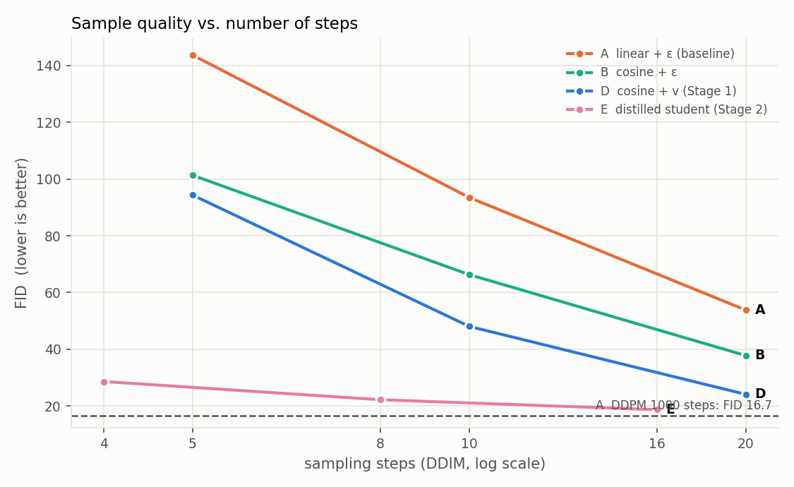
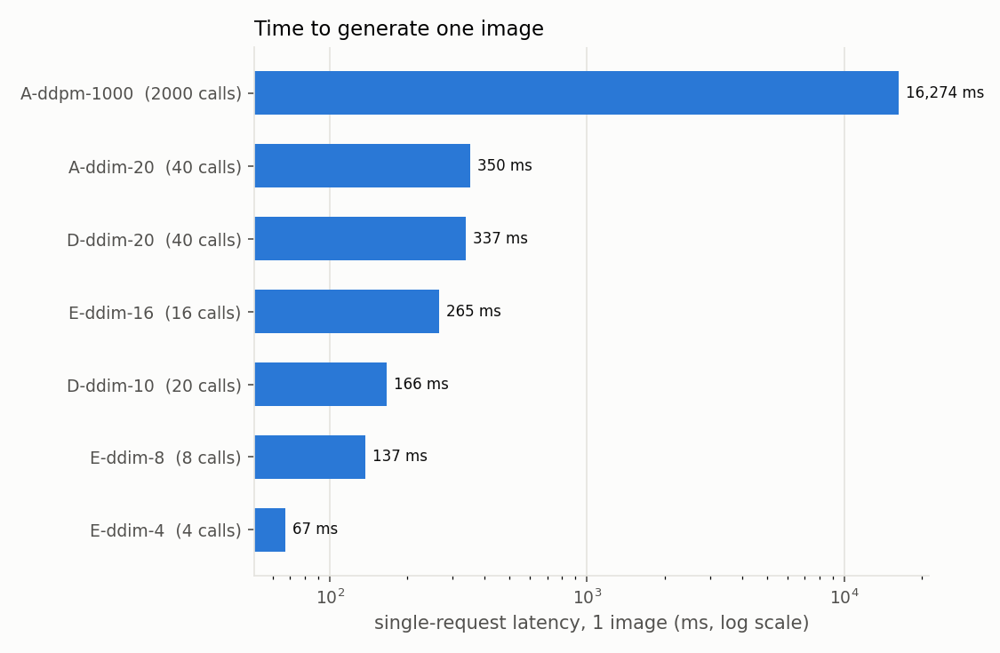
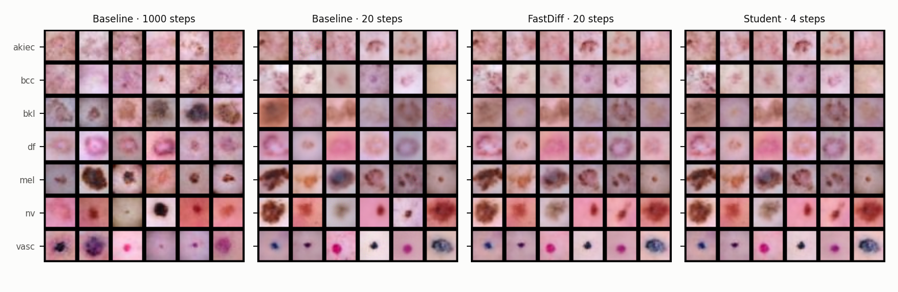
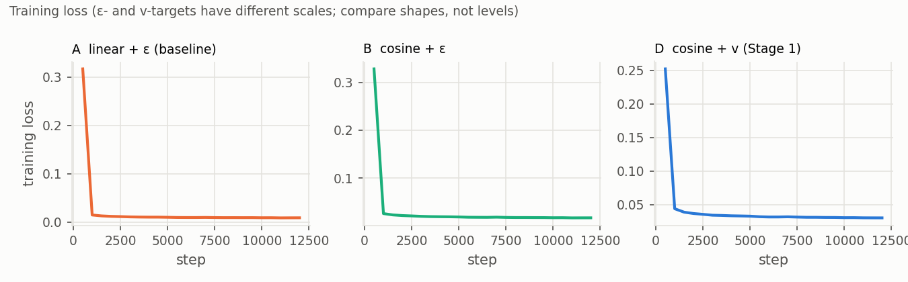
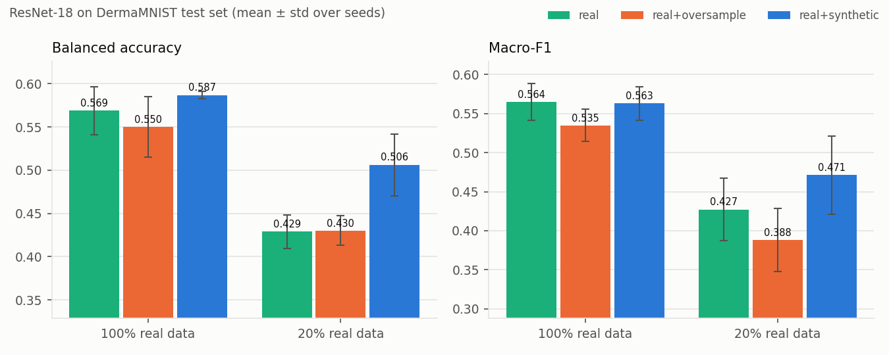
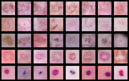

# Phase 3 — Results (auto-generated)

_Generated by `src/evaluate.py` / `src/augment_experiment.py` via `src/report.py`. Re-run those scripts to refresh._

## Headline

* **4 steps vs 1000 · 500× fewer network calls · FID 28.7 (student) vs 16.7 (baseline DDPM) · 243× lower single-image latency**
* Augmentation with 100% real data: macro-F1 -0.2 pts (0.565 → 0.563).
* Augmentation with 20% real data: macro-F1 +4.4 pts (0.427 → 0.471).
* Synthetic set (2360 images): 8.2 s with Student-4 vs ~64.5 min with the 1000-step baseline (extrapolated).

## Benchmark (quality vs. speed)

| Config | Schedule | Target | Sampler | Steps | CFG w | Net calls / img | FID ↓ | Class acc ↑ | ms / img (batched) | Single-image latency (ms) | Samples |
|---|---|---|---|---:|---:|---:|---:|---:|---:|---:|---:|
| A-ddpm-1000 | linear | eps | DDPM | 1000 | 2.0 | 2000 | 16.69 | 0.783 | 1598.00 | 16274 | 500 |
| A-ddim-5 | linear | eps | DDIM | 5 | 2.0 | 10 | 143.60 | 0.723 | 7.99 | 85 | 2000 |
| A-ddim-10 | linear | eps | DDIM | 10 | 2.0 | 20 | 93.46 | 0.717 | 16.17 | 167 | 2000 |
| A-ddim-20 | linear | eps | DDIM | 20 | 2.0 | 40 | 53.79 | 0.729 | 31.99 | 350 | 2000 |
| B-ddim-5 | cosine | eps | DDIM | 5 | 2.0 | 10 | 101.30 | 0.329 | 8.07 | 93 | 2000 |
| B-ddim-10 | cosine | eps | DDIM | 10 | 2.0 | 20 | 66.30 | 0.451 | 15.89 | 169 | 2000 |
| B-ddim-20 | cosine | eps | DDIM | 20 | 2.0 | 40 | 37.79 | 0.551 | 31.92 | 329 | 2000 |
| D-ddim-5 | cosine | v | DDIM | 5 | 2.0 | 10 | 94.31 | 0.811 | 8.00 | 86 | 2000 |
| D-ddim-10 | cosine | v | DDIM | 10 | 2.0 | 20 | 48.07 | 0.818 | 15.95 | 166 | 2000 |
| D-ddim-20 | cosine | v | DDIM | 20 | 2.0 | 40 | 24.13 | 0.812 | 31.99 | 337 | 2000 |
| E-ddim-16 | cosine | v | DDIM | 16 | 1.0 | 16 | 18.75 | 0.795 | 12.88 | 265 | 2000 |
| E-ddim-4 | cosine | v | DDIM | 4 | 1.0 | 4 | 28.67 | 0.795 | 3.17 | 67 | 2000 |
| E-ddim-8 | cosine | v | DDIM | 8 | 1.0 | 8 | 22.25 | 0.792 | 6.45 | 137 | 2000 |

Run E is the distilled student (CFG folded in, so one network call per step). FID uses Inception features (torch-fidelity) against the DermaMNIST test split; the DDPM-1000 row uses fewer samples (it is ~50× slower), which biases its FID slightly upward.

## Ablation at a fixed budget (DDIM, trailing timesteps)

| Run | Schedule | Target | FID @ 5 | FID @ 10 | FID @ 20 |
|---|---|---|---:|---:|---:|
| A | linear | eps | 143.60 | 93.46 | 53.79 |
| B | cosine | eps | 101.30 | 66.30 | 37.79 |
| D | cosine | v | 94.31 | 48.07 | 24.13 |

### Per-class accuracy of generated samples (judge classifier)

| Config | akiec | bcc | bkl | df | mel | nv | vasc |
|---|---:|---:|---:|---:|---:|---:|---:|
| A-ddpm-1000 | 0.75 | 0.92 | 0.82 | 0.50 | 0.56 | 0.93 | 1.00 |
| A-ddim-5 | 0.51 | 0.83 | 0.77 | 0.78 | 0.31 | 0.93 | 0.93 |
| A-ddim-10 | 0.54 | 0.82 | 0.76 | 0.61 | 0.39 | 0.93 | 0.96 |
| A-ddim-20 | 0.63 | 0.79 | 0.71 | 0.65 | 0.46 | 0.92 | 0.93 |
| B-ddim-5 | 0.17 | 0.48 | 0.19 | 0.04 | 0.38 | 0.72 | 0.32 |
| B-ddim-10 | 0.34 | 0.63 | 0.29 | 0.13 | 0.44 | 0.83 | 0.50 |
| B-ddim-20 | 0.52 | 0.72 | 0.41 | 0.26 | 0.46 | 0.88 | 0.61 |
| D-ddim-5 | 0.60 | 0.96 | 0.93 | 0.83 | 0.42 | 0.95 | 1.00 |
| D-ddim-10 | 0.74 | 0.92 | 0.87 | 0.74 | 0.52 | 0.94 | 1.00 |
| D-ddim-20 | 0.77 | 0.87 | 0.82 | 0.70 | 0.59 | 0.93 | 1.00 |
| E-ddim-16 | 0.74 | 0.87 | 0.80 | 0.65 | 0.61 | 0.93 | 0.96 |
| E-ddim-4 | 0.74 | 0.86 | 0.80 | 0.65 | 0.58 | 0.93 | 1.00 |
| E-ddim-8 | 0.74 | 0.87 | 0.80 | 0.65 | 0.59 | 0.93 | 0.96 |

Judge classifier (ResNet-18, class-weighted) on real test images: accuracy 0.742, balanced accuracy 0.605, macro-F1 0.579. Class accuracy of samples should be read relative to these numbers.

## Downstream utility: synthetic augmentation for rare lesions

| Real data | Arm | Train images | Balanced acc ↑ | Macro-F1 ↑ | Accuracy | Seeds |
|---|---|---:|---:|---:|---:|---:|
| 100% | real | 7007 | 0.569 ± 0.028 | 0.565 ± 0.024 | 0.761 ± 0.001 | 3 |
| 100% | real+oversample | 9367 | 0.550 ± 0.035 | 0.535 ± 0.021 | 0.739 ± 0.020 | 3 |
| 100% | real+synthetic | 9367 | 0.587 ± 0.004 | 0.563 ± 0.021 | 0.756 ± 0.011 | 3 |
| 20% | real | 1403 | 0.429 ± 0.019 | 0.427 ± 0.040 | 0.695 ± 0.041 | 3 |
| 20% | real+oversample | 1875 | 0.430 ± 0.017 | 0.388 ± 0.041 | 0.646 ± 0.051 | 3 |
| 20% | real+synthetic | 1875 | 0.506 ± 0.036 | 0.471 ± 0.050 | 0.688 ± 0.026 | 3 |

### Per-class recall (mean over seeds)

| Real data | Arm | akiec | bcc | bkl | df | mel | nv | vasc |
|---|---|---:|---:|---:|---:|---:|---:|---:|
| 100% | real | 0.47 | 0.59 | 0.52 | 0.26 | 0.42 | 0.89 | 0.83 |
| 100% | real+oversample | 0.46 | 0.54 | 0.41 | 0.30 | 0.44 | 0.88 | 0.82 |
| 100% | real+synthetic | 0.59 | 0.55 | 0.47 | 0.41 | 0.38 | 0.89 | 0.83 |
| 20% | real | 0.47 | 0.43 | 0.38 | 0.06 | 0.41 | 0.84 | 0.41 |
| 20% | real+oversample | 0.33 | 0.52 | 0.35 | 0.09 | 0.40 | 0.77 | 0.55 |
| 20% | real+synthetic | 0.52 | 0.42 | 0.44 | 0.35 | 0.40 | 0.81 | 0.61 |

Synthetic samples used for augmentation: 

### Time to generate the synthetic set

| Real data | Engine | Images | Seconds | Note |
|---|---|---:|---:|---|
| 100% | Student-4 | 2360 | 8.2 | measured |
| 100% | Baseline-1000 (DDPM) | 2360 | 3869.6 | extrapolated from 100 images |
| 20% | Student-4 | 472 | 1.5 | measured |
| 20% | Baseline-1000 (DDPM) | 472 | 772.9 | extrapolated from 100 images |

